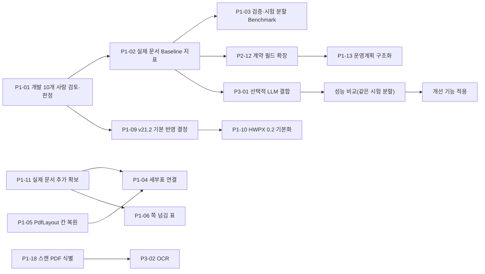
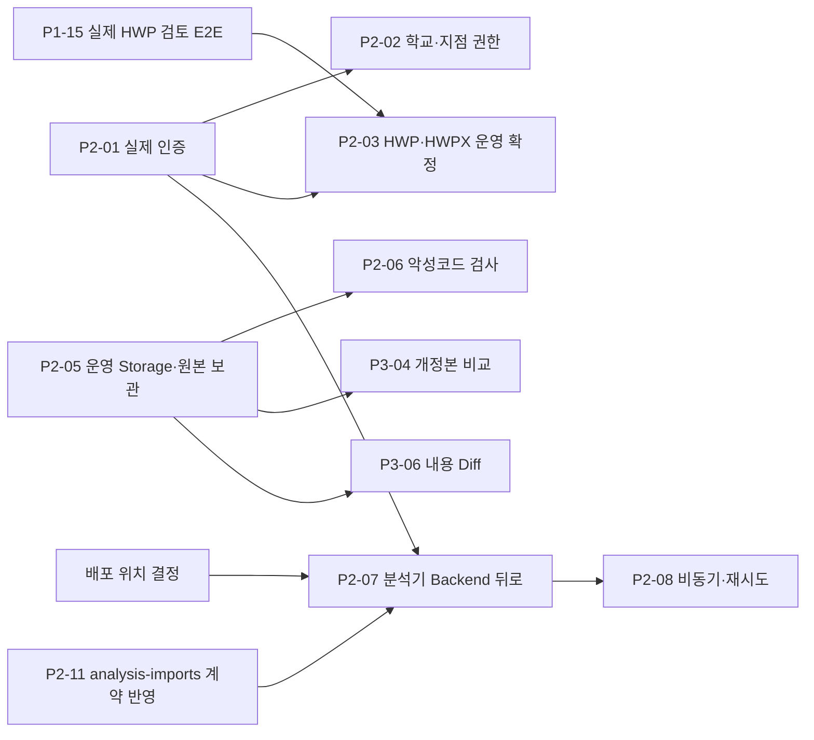
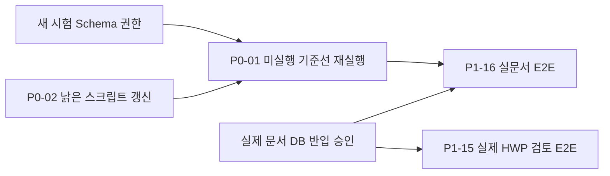

# 향후 작업 선행 관계

> ID는 `FUTURE-WORK-BACKLOG.md`와 같다.

## 1. 분석 정확도 경로

핵심: **사람 정답(P1-01) 없이는 정확도 개선·LLM 결합의 효과를 판단할 수 없다.** 지금까지의 개선(v21.1·v21.2)은 모두 "도구 기준 개수 증가"이고 맞았는지는 모른다.

## 2. 운영 경로

## 3. 시연·회귀 경로

## 4. 외부 결정 대기 (작업이 아니라 결정)

| 결정 | 막는 작업 | 출처 |
|---|---|---|
| API-OD-A01 기존 인증 | P2-01·02·03·07 | `api-contract.md` |
| API-OD-07 학업 Context Client | P2-04 | 같음 |
| API-OD-A03 File Storage | P2-05·06, P3-04·06 | 같음 |
| API-OD-A10 AI Provider·비용 | P2-14, P3-01(Backend 경로) | §47-A |
| OD-A11 보존·삭제 | P2-09 | Phase B |
| 실제 학교 문서 DB 반입·외부 전송 승인 | P1-15·16, P3-01 | 분석기 `approvals/real-docs.json`(모두 false) |
| v21.2 기본 전환 | P1-09·10 | v21.2 NEXT-STEPS |
